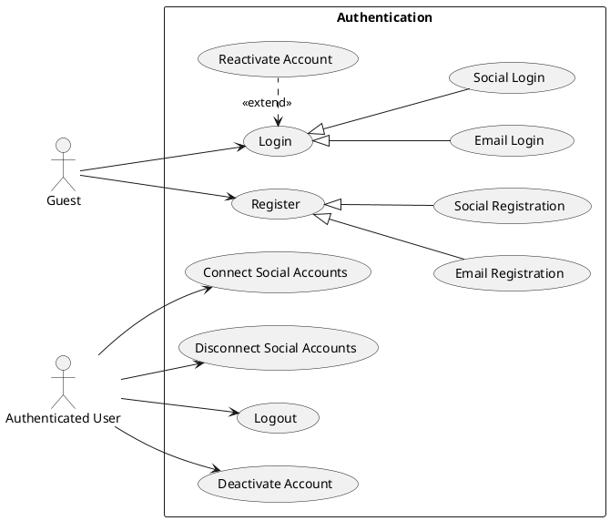
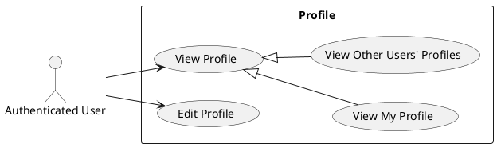
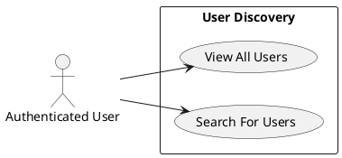
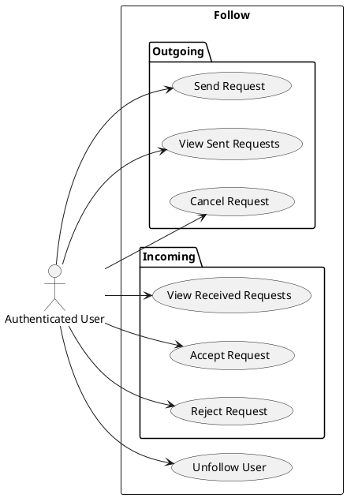
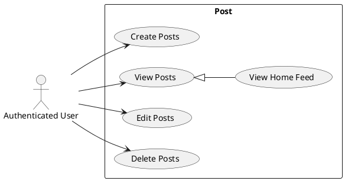
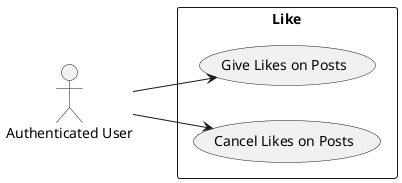
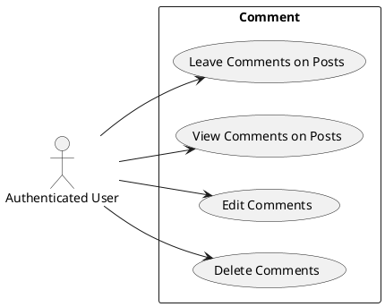

# Odin Book Project Plan

## 0. Overview

The main purposes of this project:

- Learn to build a simple text-based SNS similar to X or Threads.
- Learn NestJS.
- Sharpen TanStack React Query and Tailwind CSS skills.
- Learn to build AWS cloud infrasturcture.

## 1. Functional Requirements

### 1.1 Authentication

- Users can
  - **create** accounts with email
  - **create** accounts with social media accounts
  - **connect** social media accounts
  - **log in** with email and password
  - **log in** with social media accounts
  - **log in** with connected social media accounts
  - **log out**
  - **disconnect** social media accounts
  - **deactivate** their accounts
  - **reactivate** their accounts

### 1.2 Profile

- Users can
  - **view** their profiles.
  - **view** other users' profiles.
  - **edit** their profiles

### 1.3 User Discovery

- Users can
  - **view** all users.
  - **search for** other users.

### 1.4 Follow

- Users can
  - **send** follow requests to other users.
  - **view** their sent follow requests.
  - **cancel** their sent follow requests.
  - **view** received follow requests.
  - **accept** received follow requests.
  - **reject** received follow requests.
  - **unfollow** other users.

### 1.5 Post

- Users can
  - **create** posts.
  - **view** posts.
  - **view** home feed.
  - **edit** their posts.
  - **delete** their posts.

### 1.6 Like

- Users can
  - **give** likes on posts.
  - **cancel** likes on posts.

### 1.7 Comment

- Users can
  - **leave** comments on posts.
  - **view** comments of each post.
  - **edit** their comments.
  - **delete** their comments.

## 2. Priorities

- ### P0: Very Basic
  - Email authentication
  - Profile
  - User discovery
  - Post CRUD

- ### P1: Make SNS
  - Follow
  - Home feed
  - Like
  - Comment

- ### P2: Advanced Account Management
  - Social authentication
  - Social account connection management
  - Deactivate & reactivate user account
